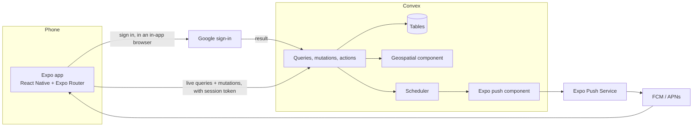

# Architecture overview

## Components

- **Expo app:** all UI. Holds no business rules beyond input validation.
- **Google:** proves who the person is. Convex Auth, running inside Convex, turns that into a session; no separate identity service is involved.
- **Convex:** the whole backend. Functions, database, live subscriptions, scheduling.
- **Geospatial component:** a spatial index beside the tables. It answers "what is near this point".
- **Expo push component:** stores device tokens and delivers notifications with batching and retries.

## The one decision that shapes everything
**Geo-matching happens on the server.** The candidate stores a home point and a radius once. The phone is never tracked.

- Location permission is foreground only, asked once, and optional (a map pin does the same job).
- No background tasks, no geofences on the device.
- The cost: no "you just walked past a job" feature. That is out of scope.

## Request paths

### Candidate opens the job stack
1. App calls the `jobs.feed` query.
2. The function reads the candidate's home point and radius.
3. It asks the geospatial component for the nearest open jobs within the radius.
4. It drops jobs the candidate already swiped on.
5. It loads the job and company records and returns cards with distance.

### Employer publishes a job
1. App calls the `jobs.publish` mutation.
2. The mutation inserts the job and adds its point to the geo index, in one transaction.
3. It schedules the `notify.fanOutNewJob` function to run immediately after.
4. Fan-out finds candidates whose radius covers the job, applies caps and quiet hours, and hands messages to the push component.

### Candidate swipes right, employer accepts
1. `swipes.record` stores the swipe with decision "pending".
2. The employer's applicants list is a live query, so the new applicant appears without a refresh.
3. `swipes.decide` sets "accepted", creates the match, and schedules a push to the candidate.

### Chat
1. Both sides subscribe to `messages.list` for the match.
2. `messages.send` inserts the message and schedules a push to the other party.
3. Convex re-runs the subscribed query, so the message appears on both phones.

## Where each concern is documented
| Concern | File |
|---|---|
| Why each tool | [stack.md](stack.md) |
| Tables and indexes | [data-model.md](data-model.md) |
| Feed and fan-out | [geo-matching.md](geo-matching.md) |
| Sign-in and roles | [auth.md](auth.md) |
| Notifications delivery | [push.md](push.md) |
| Languages and RTL | [i18n.md](i18n.md) |

## Trust boundaries
- The app is untrusted. Every Convex function checks identity and ownership itself.
- A candidate's home point is never returned to any other user. Functions return a computed distance or a distance bucket.
- Employers can only read applicants for their own jobs.
- Admin actions (approving companies) are functions callable only by users with an admin flag, run from the Convex dashboard in the MVP.
